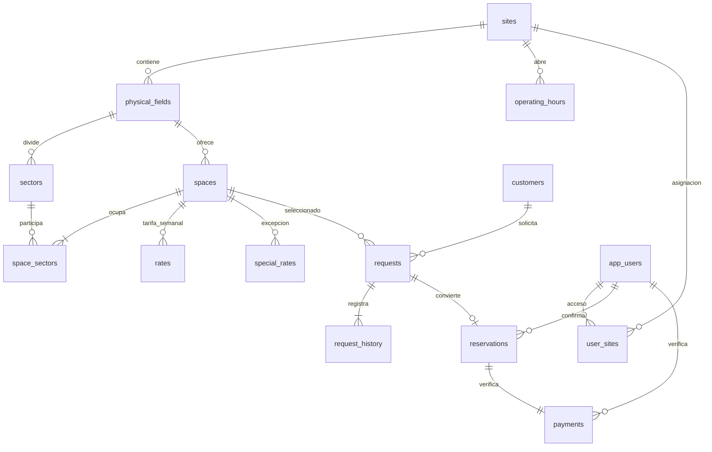

# Guía para desarrolladores

## Arquitectura actual

```text
Navegador
  React + TypeScript + Tailwind (Vite :5173)
    /api -> proxy local
      Spring Boot :8080
        SecurityFilterChain / sesión / CSRF
        ApiController: contratos HTTP y validación
        BookingService: reglas, autorización y transacciones
        JdbcTemplate + Flyway
          PostgreSQL :55432
```

Monolito inicial con separación de interfaz, API, dominio operativo y persistencia. No usa microservicios ni servicios externos para confirmar reservas. El backend se puede organizar posteriormente por módulos sin modificar los contratos públicos.

## Estructura

```text
backend/
  pom.xml
  src/main/java/pe/sportschool/
    Application.java
    SecurityConfig.java
    ApiController.java
    BookingService.java
    ApiErrors.java
  src/main/resources/
    application.properties
    db/migration/V1__schema.sql
    db/migration/V2__initial_catalog.sql
  src/test/java/pe/sportschool/BookingIntegrationTest.java
frontend/
  src/App.tsx           Portada, navegación y catálogo
  src/Booking.tsx       Grilla y solicitud pública/interna
  src/Admin.tsx         Sesión, bandeja, detalle e historial
  src/api.ts           Cliente HTTP y CSRF
  src/types.ts         Contratos y formatos
  src/styles.css       Tailwind y componentes visuales
  public/images/       Recursos locales de Sport School
scripts/               Inicio de PostgreSQL y backend en Windows
```

## Modelo de datos



### Sectores y conflictos

- San Isidro: sectores A–D; espacios F7 individuales, mitades AB/CD para F9 y ABCD para F11.
- Regatas: A/B para F7, C/D/E para F5; mitades AB/CDE para F9 y ABCDE para F11.
- Las relaciones se guardan en `space_sectors`; una combinación no se deduce automáticamente por cercanía.
- Hay conflicto si se comparte **al menos un sector** y se solapan intervalos en la misma fecha.
- Intervalos semiabiertos `[inicio, fin)`: 18–19 y 19–20 no se superponen.
- Una modalidad describe el espacio comercial, no el tamaño de cada sector.

## Consistencia

`create`, `update` y `confirm` usan `@Transactional` y `pg_advisory_xact_lock(736001)`. Todas las escrituras operativas se serializan durante su transacción; el bloqueo se libera automáticamente al finalizar o revertir. Es una solución conservadora adecuada al volumen inicial.

Al confirmar, dentro de la misma transacción:

1. Se verifica permiso sobre la sede y estado abierto.
2. Se valida el intervalo contra reservas confirmadas.
3. Se comprueba el pago completo del importe acordado.
4. Se registra reserva, pago e historial.
5. Se cierra toda solicitud abierta que comparte espacio físico y horario.

No hay una restricción SQL de exclusión independiente: la garantía depende de que las reservas se escriban mediante este servicio. No insertar reservas manualmente por SQL ni añadir endpoints que omitan el bloqueo. Al crecer, puede sustituirse por ocupaciones por sector con una restricción de exclusión en PostgreSQL.

La BD no se mantiene bloqueada mientras el cliente conversa ni espera un pago. La grilla se actualiza por consultas periódicas, sin WebSockets.

## Precios y horarios

- Horarios locales de negocio en `America/Lima`; fechas y horas enteras para las reservas.
- Historial y verificación usan `TIMESTAMPTZ`.
- `special_rates(space_id,date,hour)` prevalece sobre la tarifa semanal.
- `rates` utiliza día ISO 1=lunes a 7=domingo e intervalos de horas.
- No crear tarifas semanales superpuestas. El esquema inicial las carga sin cruces; aún no existe editor administrativo que valide futuras configuraciones.
- El servidor calcula todos los importes, usando `BigDecimal`/`NUMERIC`.
- `quoted_price` conserva el precio inicial. `agreed_price` registra el acuerdo vigente.
- Cambiar espacio o intervalo recalcula el precio. Un ajuste manual requiere motivo.
- Solo se ofrecen las próximas 180 jornadas y horas que no comenzaron.

Ejemplo de tarifa especial por bloque, ejecutado por el administrador de BD:

```sql
INSERT INTO special_rates(space_id,date,hour,amount)
VALUES (1, '2026-12-25', 18, 150)
ON CONFLICT(space_id,date,hour) DO UPDATE SET amount=EXCLUDED.amount;
```

Actualizar WhatsApp de una sede:

```sql
UPDATE sites SET whatsapp='51940958067' WHERE id=1;
```

Asignar un operador a una sede:

```sql
INSERT INTO user_sites(user_id,site_id)
SELECT id, 2 FROM app_users WHERE username='operador'
ON CONFLICT DO NOTHING;
```

Para cambios versionados, crear una migración `V3__descripcion.sql`, etc. No editar migraciones aplicadas: Flyway valida su checksum.

## Seguridad y sesiones

- Spring Security autentica con BCrypt y guarda el contexto en sesión HTTP.
- Cookie de sesión HttpOnly y SameSite=Strict. En despliegue HTTPS, añadir `server.servlet.session.cookie.secure=true`.
- `GET /api/csrf` entrega un token ligado a la sesión; enviar `X-CSRF-TOKEN` en escrituras, incluido login y solicitudes públicas.
- El login cambia el identificador de sesión. Logout invalida la sesión.
- La API interna filtra y comprueba la sede en servidor; el filtro de la UI no es el control de seguridad.
- El cliente público no recibe listas de clientes, solicitudes ni pagos.
- No se almacenan credenciales del operador en localStorage.
- No existe conexión bancaria ni API de WhatsApp; el enlace prepara texto y el humano lo envía.

Antes de exponer a Internet: configurar HTTPS, secretos, copias de seguridad, limitación de solicitudes públicas y login, registro de errores y política de datos personales. Son tareas de despliegue pendientes, no funciones activas del prototipo local.

## API

Todos los cuerpos son JSON. Los errores esperados usan `{ "message": "..." }`.

| Método | Ruta | Acceso / función |
|---|---|---|
| GET | `/api/csrf` | Público; iniciar protección CSRF |
| POST | `/api/login` | Usuario y contraseña |
| POST | `/api/logout` | Cerrar sesión |
| GET | `/api/me` | Usuario y sedes asignadas |
| GET | `/api/public/catalog` | Sedes y espacios |
| GET | `/api/public/availability?siteId=1&date=2026-10-05&modality=7` | Grilla con precios y disponibilidad |
| POST | `/api/public/requests` | Crear solicitud pública |
| GET | `/api/requests` | Últimas 300 solicitudes de las sedes asignadas |
| POST | `/api/requests` | Solicitud de atención directa |
| GET | `/api/requests/{id}` | Detalle, historial, pagos y competidores |
| PUT | `/api/requests/{id}` | Editar o reabrir |
| POST | `/api/requests/{id}/confirm` | Verificar pago completo y confirmar |

Crear solicitud:

```json
{"name":"Carlos Pérez","phone":"987654321","email":"","spaceId":1,"date":"2026-10-05","startHour":18,"endHour":20}
```

Editar:

```json
{"spaceId":1,"date":"2026-10-05","startHour":18,"endHour":20,"status":"AWAITING_PAYMENT","agreedPrice":250,"reason":"Acuerdo comercial","notes":"Enviará el comprobante por WhatsApp"}
```

Con `agreedPrice: null`, se conserva el importe vigente o se recalcula si cambió el intervalo/espacio.

Confirmar:

```json
{"amount":250,"method":"YAPE","reference":"12345678"}
```

## Recursos visuales

Fotografías y logo obtenidos de las rutas públicas de `https://sportschool.pe/images/`. No se copiaron rastreadores, formularios remotos ni scripts de terceros. La portada es una adaptación inicial; la grilla y el panel son interfaces nuevas.

## Pruebas

`BookingIntegrationTest` usa PostgreSQL real en `sportschool_test`: comprueba cruces entre modalidades, ausencia de cruces en otros sectores, confirmaciones concurrentes, reapertura con historial, pago completo, motivo de ajuste y autorización por sede. Los datos de esas pruebas no se insertan en `sportschool`.
